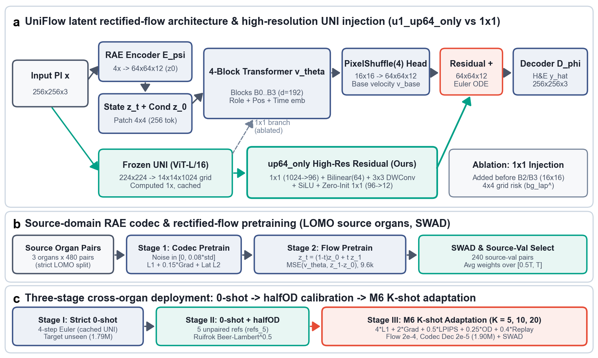
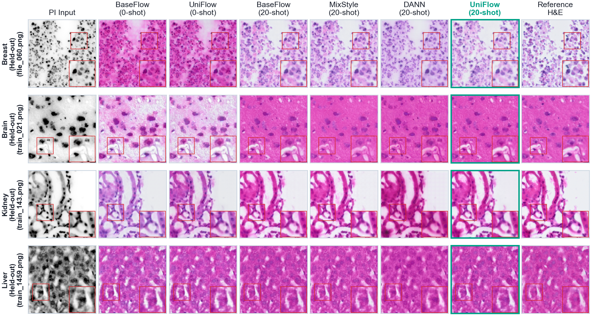
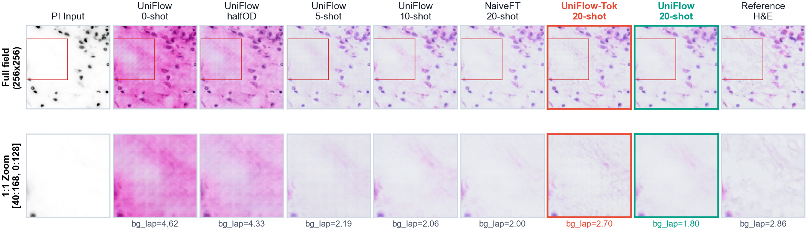
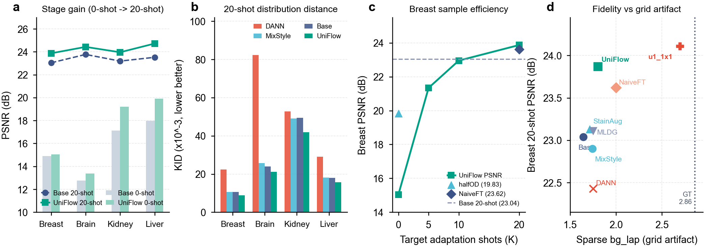

# UniFlow: Few-Shot Cross-Organ Virtual Staining via Latent Rectified Flow & High-Resolution UNI Prior Injection

[](https://github.com/dbw051273-sudo/Few-shot-supervised)
[](results/round1/round1_summary.md)
[-orange.svg)](paper/UniFlow_论文初稿.pdf)

面向树脂包埋小鼠组织 **PI → H&E** 跨器官虚拟染色的开源代码、严格零空间邻接划分基准（`UniPrior_v2 Clean-120`）、补充材料与实测归档仓库。

---

## 🌟 核心特性 (Highlights)

1. **轻量隐空间整流流匹配 (`ModularUniFlow`)**:
   - 基于四倍空间压缩、抗噪预训练的残差自编码器（RAE Codec，$256\times 256\times 3 \leftrightarrow 64\times 64\times 12$）与 $d=192$ 维 4 块 Transformer 速度预测器，仅需 **4 步确定性欧拉采样**即可实现高速高保真生成（**1.79M / 1.90M 可训练参数**，单图端到端推理 **~25–30 ms** on RTX 3080 Ti）。
2. **高频末端深度卷积 UNI 注入 (`u1_up64_only_d192`)**:
   - 相比在 $16\times 16$ 低分辨率令牌层相加后经过 `PixelShuffle(4)` 放大诱发背景棋盘纹伪影的 `u1_uni2d_1x1`（乳腺 `bg_lap=2.70`），`u1_up64_only` 仅在 $64\times 64$ 速度场输出端经 $3\times 3$ 深度可分离卷积与零初始化 $1\times 1$ 投影残差注入冻结 **UNI (ViT-L/16)** 空间网格特征，彻底抑制稀疏背景伪影（`bg_lap=1.80`）。
3. **三阶段分级部署协议**:
   - **Stage I (`0shot`)**: 严格零样本迁移（目标器官训练与验证均不可见）。
   - **Stage II (`0shot_halfOD`)**: 基于 5 张无配对目标切片（`refs_5`）的免训练 Beer–Lambert 半阻尼 Ruifrok 光密度校准。
   - **Stage III (`M6 K-shot`, $K \in \{5, 10, 20\}$)**: 冻结编码器并联合微调流网络与低学习率解码器，融合光密度锚定损失（$\mathcal{L}_{\text{OD}}$）、跨器官染色增广源域回放（`stain_aug_source_he`）与 SWAD 平坦极小值平均。
4. **严格零空间邻接防泄露划分 (`val_test_adj_pairs = 0`)**:
   - 四器官轮流留出（Leave-One-Organ-Out, LOMO）：`Breast`、`Brain`、`Kidney`、`liver`，严格校核 $|i_{\text{val}} - i_{\text{test}}| > 1$。

---

## 🖼️ 结构示意图与实验结果总览 (Overview)

<p align="center">
  <br/>
  <em>Fig. 1: UniFlow (u1_up64_only_d192) 网络结构、源域抗噪预训练与三阶段跨器官部署。</em>
</p>

<p align="center">
  <br/>
  <em>Fig. 2: 四器官 LOMO (Breast / Brain / Kidney / liver) 定性视野对照（含 64×64 局部 2 倍放大插图）。</em>
</p>

<p align="center">
  <br/>
  <em>Fig. 3: 留出乳腺 (file_4278.png) 0→20-shot 演化与 1:1 近邻放大网格伪影抑制对照 (u1_1x1 bg_lap=2.70 vs UniFlow bg_lap=1.80)。</em>
</p>

<p align="center">
  <br/>
  <em>Fig. 4: 四器官三阶段 PSNR 跃升、20-shot 无偏分布距离 KID、乳腺少样本效率曲线及保真度–网格伪影权衡。</em>
</p>

---

## 📊 四器官 20-shot 主结果汇总 (`UniPrior_v2 Clean-120`)

完整 30 组 Round-1 数据见 [results/round1/round1_summary.md](results/round1/round1_summary.md)，48 组经典 DG 基线数据见 [results/dg_baselines/dg_summary.md](results/dg_baselines/dg_summary.md)，补充指标（`FID`、非空核分割、相关性、`Params`、`ms/img`）见 [paper/UniFlow_论文初稿.pdf](paper/UniFlow_论文初稿.pdf) 附录。

| Fold | Method | PSNR ↑ | SSIM ↑ | LPIPS ↓ | KID (×10⁻³) ↓ | Cellpose Dice ↑ | F1@0.5 ↑ |
| :--- | :--- | :---: | :---: | :---: | :---: | :---: | :---: |
| **Breast** | `u0_base_d192` | 23.04 | 0.8142 | 0.1732 | 10.62 | 0.5471 | 0.5503 |
| Breast | `MixStyle` / `StainAug` / `DANN` / `MLDG` | 22.90 / 23.13 / 22.43 / 23.11 | 0.8141 / 0.8145 / 0.8061 / 0.8153 | 0.1751 / 0.1726 / 0.2076 / 0.1728 | 10.60 / 10.97 / 22.36 / 11.32 | 0.5502 / 0.5493 / 0.4942 / **0.5618** | 0.5535 / 0.5521 / 0.4887 / **0.5690** |
| **Breast** | **`UniFlow (u1_up64_only)`** | **23.90** | **0.8247** | **0.1561** | **8.79** | 0.5609 | 0.5667 |
| **Brain** | `u0_base_d192` | 23.77 | 0.7585 | 0.1265 | 23.99 | 0.7455 | 0.7160 |
| Brain | `MixStyle` / `StainAug` / `DANN` / `MLDG` | 23.54 / 23.82 / 21.33 / 23.80 | 0.7565 / 0.7569 / 0.7222 / 0.7592 | 0.1289 / 0.1266 / 0.1767 / 0.1266 | 25.72 / 26.19 / 82.30 / 24.23 | 0.7463 / 0.7418 / 0.5780 / 0.7464 | 0.7132 / 0.7129 / 0.5674 / 0.7157 |
| **Brain** | **`UniFlow (u1_up64_only)`** | **24.51** | **0.7675** | **0.1117** | **22.70** | **0.7565** | **0.7239** |
| **Kidney** | `u0_base_d192` | 23.19 | 0.8210 | 0.1218 | 49.38 | 0.7060 | 0.7321 |
| Kidney | `MixStyle` / `StainAug` / `DANN` / `MLDG` | 23.13 / 23.14 / 21.50 / 23.13 | 0.8203 / 0.8210 / 0.8021 / 0.8222 | 0.1233 / 0.1222 / 0.1524 / 0.1209 | 49.01 / 48.58 / 52.77 / 49.68 | 0.7072 / 0.7066 / 0.6848 / 0.7067 | 0.7328 / 0.7334 / 0.7019 / 0.7334 |
| **Kidney** | **`UniFlow (u1_up64_only)`** | **23.91** | **0.8312** | **0.1115** | **42.56** | **0.7117** | **0.7408** |
| **liver** | `u0_base_d192` | 23.52 | 0.7725 | 0.1231 | 18.03 | 0.7261 | **0.7478** |
| liver | `MixStyle` / `StainAug` / `DANN` / `MLDG` | 23.94 / 23.95 / 22.48 / 23.56 | 0.7728 / 0.7752 / 0.7522 / 0.7727 | 0.1237 / 0.1229 / 0.1584 / 0.1229 | 18.12 / 19.10 / 29.06 / 19.62 | 0.7209 / 0.7222 / 0.6677 / 0.7205 | 0.7424 / 0.7449 / 0.6990 / 0.7391 |
| **liver** | **`UniFlow (u1_up64_only)`** | **24.79** | **0.7836** | **0.1113** | **16.34** | **0.7299** | 0.7472 |

---

## 📁 仓库目录结构 (Repository Structure)

```text
Few-shot-supervised/
├── README.md
├── run_round1_gpu2.sh                 # Round-1 主架构与消融全流程启动脚本
├── run_dg_gpu2.sh                     # 经典 DG 四大基线启动脚本
├── run_queue2_gpu2.sh                 # Queue-2 外部基线启动脚本 (Pix2Pix / CycleGAN / UNIStainNet)
├── run_queue3_gpu2.sh                 # Queue-3 外部基线启动脚本 (CUT / I2SB)
├── eval_cache/                        # 零邻接 LOMO 切分清单 (round1_splits.json, breast_symmetric_splits.json)
├── scripts/                           # 核心模型、损失、数据、统一评测与基线脚本
│   ├── round1_models.py               # Codec + ModularUniFlow + SwadAccumulator
│   ├── round1_losses_and_data.py      # 4-fold LOMO 切分、RAE 预训练、Flow 训练与 SRA 适配
│   ├── uni_encoder.py                 # 冻结 UNI (ViT-L/16) 特征提取接口
│   ├── v2_unified_eval.py             # PSNR/SSIM/LPIPS/KID/Cellpose/bg_lap 统一评测管线
│   ├── eval_downstream.py             # 下游独立大模型(PLIP+CONCH)检索分类 + 核形态与分室OD验证
│   ├── run_round1_pipeline.py         # Round-1 序列化全量运行器 (默认 --od-weight 0.0)
│   ├── run_dg_baselines.py            # MixStyle / StainAug / DANN / MLDG 运行器
│   ├── run_queue2_baselines.py        # Queue-2 官方外部基线运行器
│   └── run_queue3_baselines.py        # Queue-3 官方 CUT + I2SB 运行器
├── third_party_official/              # 官方上游对比基线源码
│   ├── pytorch_CycleGAN_and_pix2pix/
│   ├── UNIStainNet/
│   ├── CUT/
│   └── I2SB/
├── results/                           # 完整实测指标 (JSON/CSV/MD)、逐图评估表与定性拼接图
│   ├── round1/                        # 奥卡姆精简后主实验定稿结果 (UniFlow + SRA)
│   ├── dg_baselines/                  # 四类经典 DG 基线完整结果
│   ├── downstream_mouse/              # Goal 1 下游验证 (PLIP/CONCH + 核形态/分室OD)
│   └── archive_exploratory_dwconv_od/ # 早期探索性模块归档 (3x3 DWConv 与显式 L_OD / OASRA)
└── paper/                             # 论文 LaTeX 源码、编译版 PDF、Nature-style 矢量图与绘图脚本
    ├── UniFlow_论文初稿.tex
    ├── UniFlow_论文初稿.pdf
    ├── build_paper_figures.py
    ├── nature_style.py
    └── figures/
```

---

## 🚀 快速复现 (Reproduction Commands)

```bash
# 1. 运行 Round-1 (UniFlow u1_up64_only vs u0_base + 消融)
bash run_round1_gpu2.sh round1

# 2. 复用 RAE Codec 运行四大经典 DG 基线 (MixStyle / StainAug / DANN / MLDG)
bash run_dg_gpu2.sh dg --reuse-ckpt-dir .

# 3. 运行 Queue-2 外部基线 (Pix2Pix / CycleGAN / UNIStainNet)
bash run_queue2_gpu2.sh queue2

# 4. 运行 Queue-3 外部基线 (CUT / I2SB)
bash run_queue3_gpu2.sh queue3

# 5. 生成论文全部 Nature 风格图表并编译 LaTeX
python paper/build_paper_figures.py
cd paper && xelatex -interaction=nonstopmode UniFlow_论文初稿.tex
```

---

## 📝 Citation & Acknowledgements

If you find this benchmark or **UniFlow** helpful in your research, please cite the accompanying manuscript (`UniFlow_论文初稿.pdf` included in `paper/`). Visualization scripts incorporate styling utilities from [Alto-R/nature-figure-craft](https://github.com/Alto-R/nature-figure-craft).
